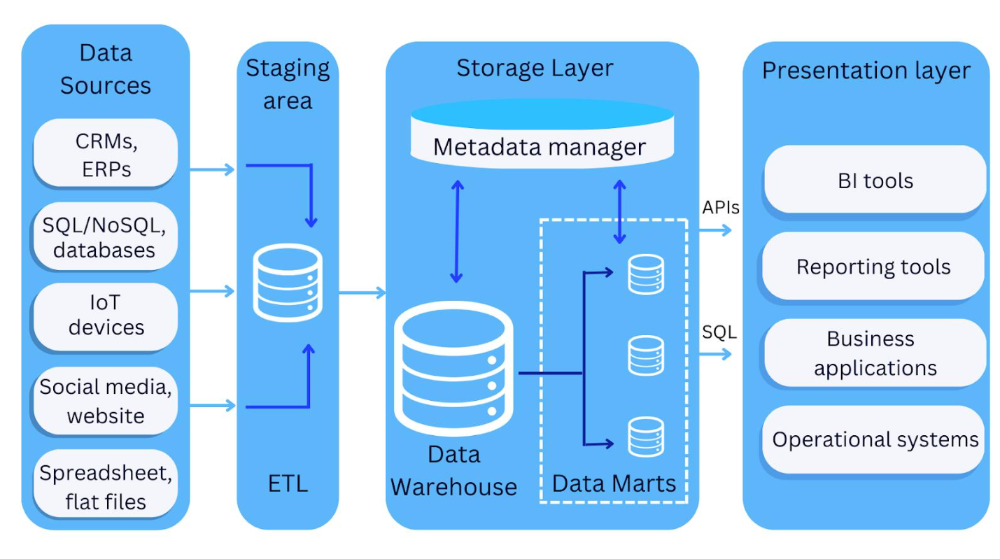
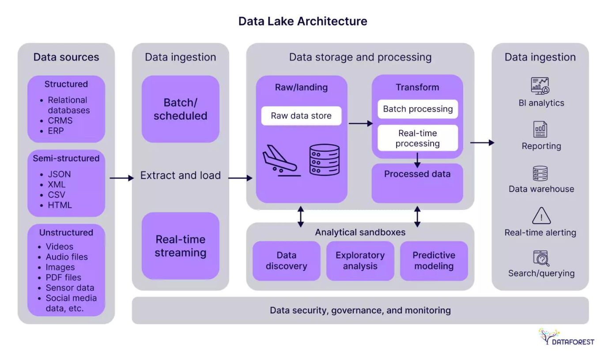
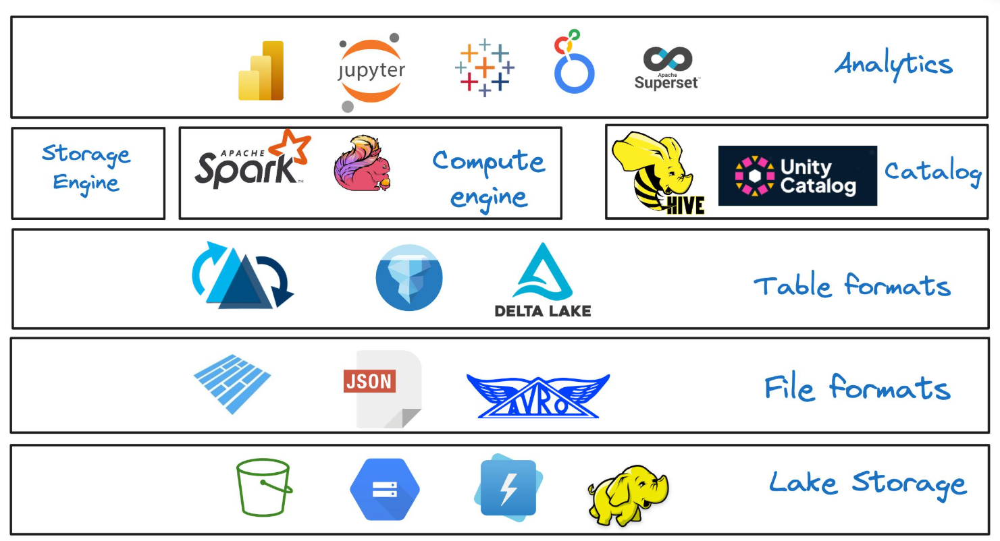
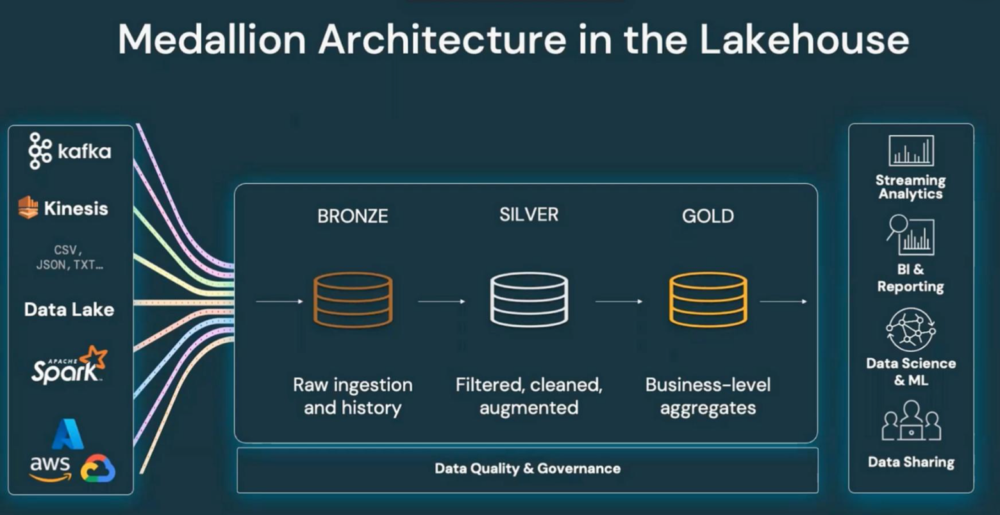
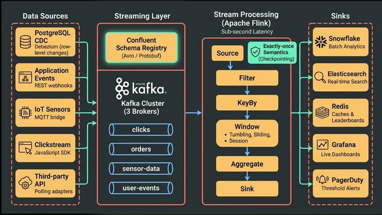
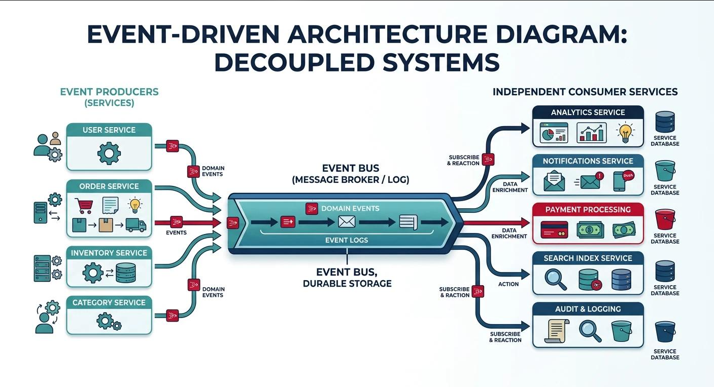
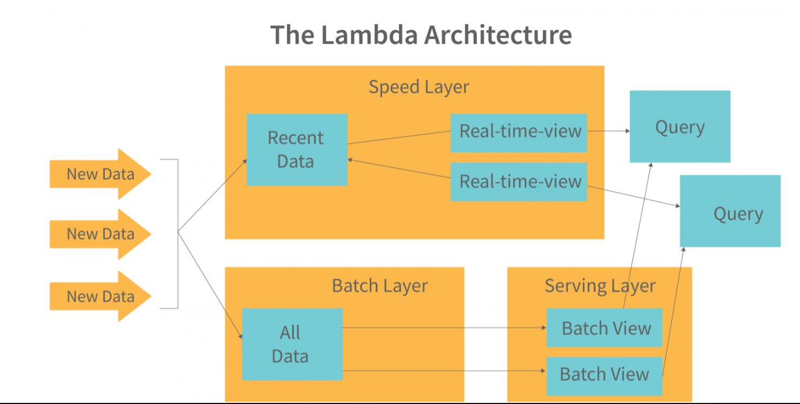
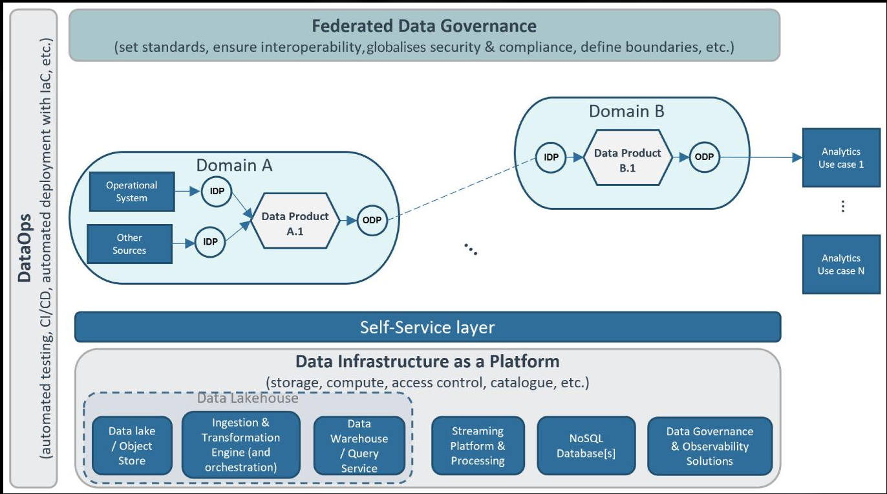
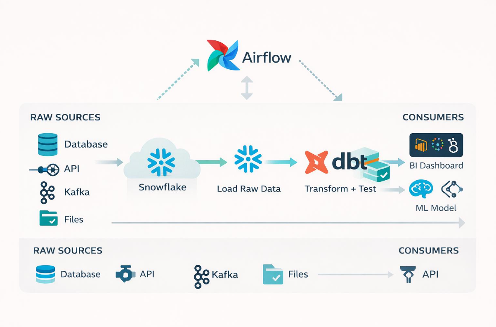

# **Data Architecture — SOP & Reference Guide**

Learning reference · Version 1.0

This document consolidates everything we've covered so far. Keep it as your reference when designing or reviewing any data engineering project.

## **Part 1 — Understanding data architecture**

### **1. What is data architecture?**

Data architecture is the overall design of how data is:

1. Generated by source systems.
2. Collected and ingested.
3. Stored.
4. Processed and transformed.
5. Governed and secured.
6. Delivered to consumers.
7. Monitored, maintained, and recovered.

Think of it as the blueprint of an entire data environment.

For example, imagine an international retail company.

It has:

- 50 retail stores.
- An e-commerce application.
- Customer management software.
- ERP and finance systems.
- Inventory databases.
- Payment gateways.
- Mobile applications.

All these systems generate data. The company needs to bring that data together for sales reporting, inventory management, customer analytics, financial reporting, and machine learning.

The data architecture defines how all these pieces work together.

### **2. Data pipeline vs data platform vs data architecture**

These are related, but they are not interchangeable.

| Concept                      | Meaning                                             | Example                                                           |
| ---------------------------- | --------------------------------------------------- | ----------------------------------------------------------------- |
| Data pipeline                | Moves and processes data between systems            | SQL Server → GCS → Snowflake                                      |
| Data platform                | Provides shared capabilities for data workloads     | GCS, Snowflake, Airflow, dbt, governance                          |
| Data architecture            | Defines the overall structure and design            | How sources, storage, processing, security and consumers interact |
| Enterprise data architecture | Defines how data is managed across the organization | Sales, HR, Finance, Operations and enterprise analytics           |

**Example:**

Your AdventureWorks pipeline is one data pipeline.

Your complete environment, including GCS, Snowflake, Airflow, dbt, Terraform, CI/CD, data quality and monitoring, is a small data platform.

The design decisions connecting those components form its data architecture.

## **Part 2 — The fundamental layers of a data architecture**

A typical enterprise data platform can be organized into these layers.

## **Enterprise data platform — logical architecture**
______________________________________________________________________________________________________________________
|
|                       **1. Data Sources**
|            ERP · CRM · SQL Server · Oracle · APIs · Files · Applications · IoT
|                                   ↓
|                        **2. Ingestion Layer**
|            Batch · Streaming · CDC · API ingestion · File ingestion
|                                   ↓
|                       **3. Landing and Storage Layer**
|            Raw data · Data lake · Object storage · Historical retention
|                                   ↓
|                       **4. Processing and Transformation**
|            Python · SQL · Spark · dbt · Data cleansing · Aggregation
|                                   ↓
|                       **5. Analytical Storage**
|            Data warehouse · Lakehouse · Data marts
|                                   ↓
|                        **6. Data Products and Consumption**|
|            BI · Dashboards · APIs · Applications · Data Science · ML
______________________________________________________________________________________________________________________

**Cross-cutting capabilities — apply across the platform**

Security
Governance
Data quality
Observability
Orchestration
CI/CD
Metadata and lineage
Cost management

Let's understand each layer.

### **Layer 1: Data Sources**

Where data originates.

Examples:

| Source category         | Examples                       |
| ----------------------- | ------------------------------ |
| Relational databases    | SQL Server, Oracle, PostgreSQL |
| Enterprise applications | SAP, Salesforce, Dynamics      |
| APIs                    | REST, GraphQL                  |
| Files                   | CSV, JSON, XML, Parquet        |
| Event sources           | Kafka, RabbitMQ, Pub/Sub       |
| Unstructured sources    | Images, PDFs, documents, logs  |

An architect must understand the source's capabilities and limitations.

For example:

- Does the database support CDC?
- Can the API handle pagination?
- Does the source have rate limits?
- Is the data updated every second or once daily?
- Are records uniquely identifiable?

### **Layer 2: Ingestion**

Ingestion is how data enters the platform.

There are several approaches:

- Batch ingestion
- Streaming ingestion
- CDC ingestion
- API-based ingestion
- File-based ingestion

We'll study these in detail in Part 4.

### **Layer 3: Landing and storage**

This is where incoming data is persisted.

Common storage options include:

- Object storage: GCS, Amazon S3, Azure Data Lake Storage.
- Relational databases.
- Data warehouses.
- Lakehouse storage formats.

A major architectural principle is to separate ingestion from downstream processing where appropriate.

For example:

```
Source Database
      |
      v
  Ingestion
      |
      v
  Raw Storage
      |
      +------> Analytics
      |
      +------> Machine Learning
      |
      +------> Historical Replay
```

If the downstream warehouse is unavailable, the raw data can remain safely stored until processing resumes, provided retention and durability have been designed correctly.

### **Layer 4: Processing and transformation**

This is where data is cleaned, validated, enriched and transformed.

Examples:

- Python
- SQL
- Apache Spark
- dbt
- Apache Beam

Typical transformations:

```
Raw Customer Data
       |
       v
Remove duplicates
       |
       v
Standardize formats
       |
       v
Validate records
       |
       v
Join customer information
       |
       v
Create analytical models
```

### **Layer 5: Analytical storage**

This layer provides data in a form suitable for analytical queries.

Examples:

- Snowflake
- BigQuery
- Amazon Redshift
- Azure/Fabric analytical services
- Lakehouse tables

### **Layer 6: Consumption**

Who uses the data?

- Tableau and Power BI users.
- Business analysts.
- Finance teams.
- Data scientists.
- Machine learning applications.
- Operational applications.
- APIs and external consumers.

A good architecture considers consumers before selecting technologies.

## **Part 3 — Architecture concepts you must understand**

These concepts apply regardless of whether you use GCP, AWS, Azure or an on-premises environment.

### **1. Logical architecture vs physical architecture**

**Logical architecture** describes what capabilities and components are required, without committing to specific products.

Example:

```
Source Systems
      |
      v
Ingestion
      |
      v
Central Storage
      |
      v
Transformation
      |
      v
Analytics
```

**Physical architecture** describes how those capabilities are implemented using actual technologies.

```
SQL Server
    |
    v
Python + Airflow
    |
    v
Google Cloud Storage
    |
    v
Pub/Sub
    |
    v
Snowpipe
    |
    v
Snowflake
    |
    v
dbt
    |
    v
Tableau
```

The logical design should normally come before the physical implementation.

### **2. Data plane vs control plane vs security plane**

These are ways of organizing the responsibilities of a platform.

| Plane          | Responsibility                    | Examples                           |
| -------------- | --------------------------------- | ---------------------------------- |
| Data plane     | Moves, stores and processes data  | GCS, Snowflake, Spark              |
| Control plane  | Coordinates and manages workloads | Airflow, scheduling, configuration |
| Security plane | Controls access and protects data | IAM, RBAC, encryption, masking     |

A production data platform needs all three.

### **3. Cross-cutting concerns**

These are capabilities that affect multiple layers rather than belonging to only one component.

For example, security applies to:

- Source databases.
- Ingestion credentials.
- Raw storage.
- Transformation environments.
- Warehouses.
- BI dashboards.
- APIs.

The same applies to governance, quality, monitoring and cost management.

### **4. Decoupling**

Decoupling means reducing direct dependencies between components.

Poorly coupled example:

```
Database
   |
   v
Transformation
   |
   v
BI
```

If transformation fails, the entire flow may be affected.

A more decoupled approach:

```
Database
   |
   v
Ingestion
   |
   v
Durable Raw Storage
   |
   v
Transformation
   |
   v
Warehouse
```

The storage layer provides a boundary between ingestion and processing.

### **5. Scalability**

The ability to handle increasing workloads.

For example:

```
Current: 100 GB/day
Future:    5 TB/day
```

Scalability considerations include:

- Parallel ingestion.
- Partitioning.
- Distributed processing.
- Storage capacity.
- Query optimization.
- Workload isolation.
- Network throughput.
- Orchestration concurrency.

### **6. Reliability and availability**

Reliability means the platform consistently performs its intended functions.

Availability means users and systems can access the platform when required.

Important concepts:

| Concept                | Meaning                                                             |
| ---------------------- | ------------------------------------------------------------------- |
| High availability (HA) | Minimize service interruption                                       |
| Fault tolerance        | Continue operating despite failures                                 |
| Retry                  | Attempt a failed operation again                                    |
| Idempotency            | Repeating an operation does not create unintended duplicate effects |
| Checkpointing          | Record progress so processing can resume                            |
| Replay                 | Process previously captured data again                              |
| Disaster recovery (DR) | Restore service after a major failure                               |

### **7. Logical and physical data modelling**

Data modelling describes how data entities, relationships and attributes are organized.

The three broad levels:

- Conceptual: business entities and relationships.
- Logical: attributes, keys, relationships and business rules.
- Physical: actual tables, columns, indexes, data types and platform-specific implementation.

Example:

```
Conceptual:
Customer places Order

Logical:
Customer (CustomerID, Name)
Order (OrderID, CustomerID, OrderDate)

Physical:
ADVWORKS.DBO.DIMCUSTOMER
ADVWORKS.DBO.FACTINTERNETSALES
```

We'll have a dedicated module on data modelling.

# **Part 4 — Data architecture patterns**

This is the reference catalogue of patterns we have introduced.

An important distinction: these are not all the same type of pattern. Some describe storage architecture, some describe processing, some describe modelling, and others describe organizational ownership.

## **A. Storage and analytical architecture patterns**

### **1. Data Warehouse Architecture**



**Purpose:** Structured analytical reporting.

```
Operational Sources
       |
       v
   ETL / ELT
       |
       v
  Data Warehouse
       |
       +----> Fact Tables
       |
       +----> Dimension Tables
       |
       v
    BI / Reports
```

Example: A retail company stores sales, customers, products and inventory data in Snowflake.

Use when:

- Structured analytical queries are the main requirement.
- Business reporting and consistent metrics are important.
- Users need governed datasets.

Consider alternatives or extensions when:

- You need to retain massive amounts of diverse raw data.
- You need large-scale processing of unstructured data.
- You need low-latency operational event processing.

### **2. Data Lake Architecture**



**Purpose:** Store large amounts of data in different formats, often in its original form.

```
Sources
   |
   v
Object Storage / Data Lake
   |
   +----> Raw data
   +----> Historical data
   +----> JSON / CSV
   +----> Logs / Events
   |
   v
Processing and Analytics
```

Example: A bank stores transaction events, customer data, audit logs and historical files in cloud object storage.

Use when:

- Data variety is high.
- Raw data retention is important.
- Multiple downstream processing use cases exist.

Risks to manage:

- Poorly governed lakes can become data swamps.
- Data discovery and ownership can become difficult.
- File formats, partitioning and lifecycle management need design.

### **3. Lakehouse Architecture**



**Purpose:** Combine data-lake flexibility with warehouse-like management and analytical capabilities.

```
Data Sources
     |
     v
Object Storage
     |
     v
Open Table Format
     |
     +----> SQL Analytics
     +----> Data Engineering
     +----> BI
     +----> ML
```

Common technologies and formats:

- Delta Lake
- Apache Iceberg
- Apache Hudi
- Databricks

Important: a lakehouse is an architectural approach, not simply a synonym for Databricks or a data lake with a warehouse attached.

### **4. Medallion Architecture**



**Purpose:** Organize data into progressively refined layers.

```
Sources
   |
   v
BRONZE
Raw or minimally processed
   |
   v
SILVER
Cleaned and standardized
   |
   v
GOLD
Business-ready datasets
   |
   v
BI / ML / Applications
```

Example:

| Layer  | Customer data                      |
| ------ | ---------------------------------- |
| Bronze | Original customer records          |
| Silver | Deduplicated and validated records |
| Gold   | Customer 360 analytical dataset    |

Your project's Landing → Prepare → Normalize → Schematize → Marketplace approach has a similar progressive-refinement idea, although the exact layer definitions are different.

**Remember:** Medallion is a data organization pattern. It can be implemented in a lakehouse or other data platform.

## **B. Ingestion and processing patterns**

### **5. Batch Architecture**

```
Source
  |
  v
Scheduled Extraction
  |
  v
Storage
  |
  v
Transformation
  |
  v
Warehouse
```

Data is processed periodically.

Example: A company loads the previous day's sales at 1 AM.

Use when daily or hourly freshness is sufficient.

### **6. Streaming Architecture**



```
Event Sources
     |
     v
Message Broker
     |
     v
Stream Processing
     |
     v
Target System
```

Data is processed continuously or in small, frequent increments.

Example: A payment company analyzes transactions to detect suspicious activity.

Use when low latency matters.

### **7. CDC — Change Data Capture**

**Purpose:** Capture changes made in source databases rather than repeatedly extracting complete tables.

```
Source Database
      |
      v
 Change Capture
      |
      v
  Change Events
      |
      v
Target Database / Lake / Warehouse
```

Common change types:

- INSERT
- UPDATE
- DELETE

Example:

A customer table contains 100 million records, but only 50,000 records change daily.

Instead of extracting the entire table every day, CDC captures those changes.

CDC is an ingestion technique, not a complete end-to-end architecture by itself.

### **8. Event-Driven Architecture**



**Purpose:** Allow systems to react to events without requiring tight direct dependencies between producers and consumers.

```
       Order Created
             |
             v
          Event Bus
          /   |   \
         v    v    v
     Billing Inventory Analytics
```

Example:

When an order is created:

- Inventory updates stock.
- Billing initiates payment.
- Notification sends an email.
- Analytics records the event.

Event-driven architecture is broader than streaming. An event can trigger an asynchronous action even when the processing isn't a continuous stream.

## **C. Combined processing patterns**

### **9. Lambda Architecture**

**Purpose:** Support both historical batch processing and low-latency streaming.



```
             Data
               |
        +------+------+
        |             |
        v             v
    Batch Layer   Speed Layer
        |             |
        v             v
   Batch Views   Real-time Views
        |             |
        +------+------+
               |
               v
          Serving Layer
```

Trade-off: two processing paths can create duplicated logic and additional operational complexity.

### **10. Kappa Architecture**

**Purpose:** Use a streaming-first architecture where the event log is the primary processing source.

```
Events
   |
   v
Event Log
   |
   v
Stream Processing
   |
   v
Serving Layer
```

Historical recomputation can be performed by replaying retained events, provided the event history and replay mechanism support it.

| Lambda                      | Kappa                              |
| --------------------------- | ---------------------------------- |
| Batch + streaming paths     | Primarily streaming path           |
| Two processing approaches   | One primary processing approach    |
| More operational complexity | Potentially simpler                |
| Useful for mixed workloads  | Useful for event-centric workloads |

Neither is universally superior.

## **D. Data modelling and warehouse design patterns**

### **11. Kimball — Dimensional Modelling**

**Purpose:** Design analytical models that are easy to query and understand.

```
             DimCustomer
                  |
DimDate ---- FactSales ---- DimProduct
                  |
              DimStore
```

Fact tables store measurable business events.

Dimension tables describe the business entities associated with those events.

Example:

- FactSales: sales amount, quantity, discount.
- DimCustomer: customer name, location, customer category.
- DimProduct: product name, category, brand.
- DimDate: calendar date, month, quarter, year.

### **12. Inmon — Enterprise Data Warehouse**

**Purpose:** Build a centralized, integrated enterprise data warehouse, traditionally using normalized structures, with downstream data marts for consumption.

```
Sources
   |
   v
Enterprise Data Warehouse
   |
   +----> Sales Data Mart
   |
   +----> Finance Data Mart
   |
   +----> HR Data Mart
```

### **13. Data Vault**

**Purpose:** Integrate data from multiple changing sources while preserving historical information and traceability.

Its three core structures are:

| Structure | Responsibility                     | Example               |
| --------- | ---------------------------------- | --------------------- |
| Hub       | Business keys                      | CustomerID            |
| Link      | Relationships                      | Customer–Order        |
| Satellite | Descriptive attributes and history | Name, Address, Status |

A simplified structure:

```
        HUB_CUSTOMER
              |
              |
         LINK_ORDER
              |
              |
          HUB_ORDER

    SAT_CUSTOMER
    SAT_ORDER
```

Data Vault is especially useful for complex enterprise integration and auditability. It is not automatically the best serving model for BI; dimensional marts are often created downstream.

### **Kimball vs Inmon vs Data Vault**

| Approach   | Main focus                       | Typical use                           |
| ---------- | -------------------------------- | ------------------------------------- |
| Kimball    | Dimensional analytics            | BI and reporting                      |
| Inmon      | Centralized enterprise warehouse | Enterprise integration                |
| Data Vault | Historical source integration    | Complex, evolving source environments |

## **E. Organizational and integration patterns**

### **14. Data Mesh**



**Purpose:** Organize data ownership around business domains.

```
       Shared Data Platform
                |
      +---------+---------+
      |         |         |
      v         v         v
    Sales     Finance     HR
      |         |         |
      v         v         v
   Product   Product    Product
```

Its four commonly discussed principles:

1. Domain-oriented ownership.
2. Data as a product.
3. Self-service data platform.
4. Federated computational governance.

It changes how an organization owns, publishes and manages data. It is not a replacement for storage, ingestion or processing technologies.

### **15. Data Fabric**

**Purpose:** Integrate and govern data across heterogeneous environments using capabilities such as metadata, lineage, discovery, integration and automation.

```
 SQL Server    Oracle     SAP      Cloud
      \          |         |        /
       \         |         |       /
        +-------------------------+
        |       Data Fabric       |
        |                         |
        | Metadata                |
        | Lineage                 |
        | Discovery               |
        | Governance              |
        | Integration             |
        +-------------------------+
                    |
                    v
             Data Consumers
```

### **Data Mesh vs Data Fabric**

| Data Mesh                                 | Data Fabric                                  |
| ----------------------------------------- | -------------------------------------------- |
| Organizational and architectural approach | Data integration and management architecture |
| Domain ownership                          | Connected data environments                  |
| Data products                             | Metadata, lineage, discovery and automation  |
| Federated governance                      | Consistent governance capabilities           |

# **Part 5 — Cloud architecture mapping**

The architecture should be driven by capabilities, not by product names.

Here are the major mappings to know.

| Capability         | GCP                   | Azure                                  | AWS                  |
| ------------------ | --------------------- | -------------------------------------- | -------------------- |
| Object storage     | GCS                   | ADLS Gen2                              | S3                   |
| Event messaging    | Pub/Sub               | Event Hubs / Service Bus               | Kinesis / SNS / SQS  |
| Data warehouse     | BigQuery              | Synapse / Fabric                       | Redshift             |
| Managed Kubernetes | GKE                   | AKS                                    | EKS                  |
| Serverless compute | Cloud Run / Functions | Container Apps / Functions             | Lambda / ECS Fargate |
| Secrets            | Secret Manager        | Key Vault                              | Secrets Manager      |
| Monitoring         | Cloud Monitoring      | Azure Monitor                          | CloudWatch           |
| IAM                | Cloud IAM             | Entra ID / Azure RBAC                  | IAM                  |
| Managed Airflow    | Cloud Composer        | Managed Airflow options / alternatives | MWAA                 |
| Spark processing   | Dataproc              | Azure Databricks / Synapse Spark       | EMR                  |
| Container registry | Artifact Registry     | ACR                                    | ECR                  |

These are capability comparisons, not always exact equivalents. For example, Azure Event Hubs and Service Bus have different messaging models, just as AWS Kinesis and SQS serve different use cases.

Your Snowflake warehouse can also be used with infrastructure on different clouds, subject to the selected Snowflake deployment region and integration design.

# **Part 6 — Enterprise-level example: How all these concepts work together**

Let's design a hypothetical global retail company.

**Business environment:**

- 100+ data sources.
- SQL Server, Oracle, SAP and Salesforce.
- E-commerce APIs.
- CSV and JSON files.
- Millions of transactions per day.
- Daily reporting.
- Some operational dashboards require five-minute freshness.
- Customer information includes PII.
- Multiple business domains.
- Future machine learning use cases.

### **Step 1: Understand the requirements**

First classify the requirements.

| Requirement               | Architectural implication                |
| ------------------------- | ---------------------------------------- |
| 100+ sources              | Standardized ingestion framework         |
| Multiple source types     | Database, API and file connectors        |
| Daily reports             | Batch ingestion can work                 |
| Five-minute freshness     | CDC or frequent incremental ingestion    |
| High data volumes         | Parallel processing and scalable storage |
| PII                       | Encryption, masking and access controls  |
| Historical analysis       | Raw retention and historical modelling   |
| ML requirements           | Accessible, reusable analytical data     |
| Multiple business domains | Ownership and data product strategy      |

### **Step 2: Design the architecture**

_____________________________________________________________________________________________________________________________________________________
###### **Global retail enterprise data platform**
_____________________________________________________________________________________________________________________________________________________
|
|                                             **Source systems**
|                        SQL Server · Oracle · SAP · Salesforce · APIs · Files · Events
|
|                                                       ↓
|
|
|            **Batch ingestion**                                              **Change/event ingestion**
|    Scheduled loads · File ingestion · API extraction                    CDC · Message brokers · Event streams
|           
|                                                       ↓
|           
|                                          **Central landing and data lake**
|                                     Raw files · Events · Historical data · Replay
|
|                                                       ↓
|
|                                         **Processing and transformation**
|                                     Spark · SQL · Python · dbt · Data quality
|                                                       ↓
|                                            **Analytical storage**
|                                            Warehouse / Lakehouse · Dimensional models · Data marts
|
|                                                       ↓
|
|            **Business analytics**                                              **Advanced analytics**
|            Tableau · Power BI · Reports                                         ML · Data science · APIs
|          
|            Platform-wide controls
|            Security · Governance · Metadata · Lineage · Observability · Orchestration · CI/CD · Cost · HA/DR
_______________________________________________________________________________________________________________________________________________________

### **Step 3: Select the appropriate patterns**

This hypothetical enterprise might use:

| Area                                 | Selected pattern                                      |
| ------------------------------------ | ----------------------------------------------------- |
| Historical raw storage               | Data Lake                                             |
| Analytical storage                   | Warehouse or Lakehouse                                |
| Data refinement                      | Medallion-like layers                                 |
| Daily ingestion                      | Batch                                                 |
| Five-minute updates                  | CDC or frequent incremental loads                     |
| Event notifications                  | Event-driven                                          |
| Historical and real-time combination | Lambda-like approach, if justified                    |
| BI modelling                         | Kimball dimensional models                            |
| Complex historical integration       | Data Vault, where justified                           |
| Domain ownership                     | Data Mesh principles, if organizationally appropriate |
| Metadata and integration             | Data Fabric capabilities                              |

Notice that a real enterprise architecture is often a **combination of patterns**, not a choice of one pattern for the entire company.

### **Step 4: Define operations and reliability**

The design is not complete until you address:

- What happens when ingestion fails?
- How are duplicate events handled?
- How do we recover from a failed transformation?
- How do we detect missing data?
- How are schema changes managed?
- How do we track data lineage?
- How do we prevent unauthorized access?
- How do we recover from a regional outage?
- How do we control cloud and compute costs?

These are architecture requirements, not optional additions.

# **Part 7 — Standard Operating Procedure for designing a data architecture**

This is the reusable SOP. Follow these steps whenever you start a new data engineering project.

Core architecture workflow

## **Step 1 — Understand the business problem**

Do not start by choosing Kafka, Spark, Snowflake or Databricks.

Understand:

- What business problem are we solving?
- Who will consume the data?
- What decisions will the data support?
- What is the expected freshness?
- What are the business-critical datasets?

**Deliverable:** Business requirements document.

## **Step 2 — Discover and classify source systems**

Create a source inventory.

| Source     | Type           | Approx. volume | Frequency | CDC support              |
| ---------- | -------------- | -------------- | --------- | ------------------------ |
| SQL Server | Database       | 500 GB         | Daily     | Yes                      |
| Oracle     | Database       | 2 TB           | Hourly    | Depends on configuration |
| SAP        | Enterprise app | 100 GB         | Daily     | Depends on interface     |
| REST API   | API            | 5 GB           | Hourly    | Usually API-specific     |
| CSV files  | Files          | 50 GB          | Daily     | Not inherently           |

The values above are illustrative.

**Deliverable:** Source inventory and source capability assessment.

## **Step 3 — Define non-functional requirements**

These are the quality and operating requirements of the platform.

| Requirement  | Example                                         |
| ------------ | ----------------------------------------------- |
| Scalability  | Handle growth from 1 TB to 10 TB/day            |
| Latency      | Selected datasets available within five minutes |
| Availability | 99.9% service availability target               |
| Security     | PII encrypted and restricted                    |
| Reliability  | Retry and recovery mechanisms                   |
| Performance  | Critical reports return within agreed SLA       |
| Cost         | Stay within approved monthly budget             |
| Recovery     | Defined RPO and RTO                             |

Two important terms:

- **RPO:** How much data loss, measured in time, can the business tolerate after a failure?
- **RTO:** How long can recovery take?

## **Step 4 — Choose the ingestion pattern**

Use the requirements to choose:

- Batch
- Streaming
- CDC
- API extraction
- File ingestion
- Hybrid ingestion

Example:

```
Daily ERP data --------> Batch
Customer DB changes ---> CDC
Payment events --------> Streaming
Partner API -----------> Scheduled API ingestion
```

## **Step 5 — Design storage architecture**

Decide:

- Do we need a data lake?
- Do we need a warehouse?
- Is a lakehouse appropriate?
- What is the raw retention period?
- Which file formats will be used?
- How will data be partitioned?
- What are the backup and lifecycle requirements?

## **Step 6 — Design processing architecture**

Choose the processing approach:

- SQL for relational transformations.
- Python for extraction, APIs and application logic.
- Spark for distributed processing.
- dbt for warehouse transformations.
- Stream processing for continuous event processing.

Don't select a tool because it is popular. Select it because its capabilities fit the workload.

## **Step 7 — Design the data modelling approach**

Define:

- Conceptual model.
- Logical model.
- Physical model.
- Facts and dimensions.
- Business keys and surrogate keys.
- Grain of fact tables.
- Slowly changing dimensions.
- Historical data requirements.
- Data contracts and schema evolution.

## **Step 8 — Design security and governance**

Define:

- Authentication.
- Authorization.
- RBAC and least privilege.
- Encryption at rest and in transit.
- PII classification.
- Masking and row-level security.
- Data ownership.
- Retention and deletion.
- Audit logs.
- Metadata and lineage.

## **Step 9 — Design orchestration and automation**

Define:

- Workflow dependencies.
- Scheduling.
- Retries.
- Backfills.
- Checkpointing.
- Failure handling.
- Environment separation.
- Configuration management.

For example, Airflow can orchestrate extraction, validation, transformation and publication.

## **Step 10 — Design data quality and observability**

Define what will be measured and monitored.

Examples:

| Metric              | What it detects               |
| ------------------- | ----------------------------- |
| Row count           | Missing or unexpected records |
| Null percentage     | Missing mandatory values      |
| Duplicate count     | Duplicate business keys       |
| Freshness           | Delayed data                  |
| Schema changes      | Unexpected structural changes |
| Processing duration | Performance degradation       |
| Failed records      | Data quality issues           |

Monitoring tells you something failed. Observability helps you investigate why and understand the impact.

## **Step 11 — Design CI/CD and infrastructure**

Plan:

- Development, test and production environments.
- Git-based version control.
- Automated tests.
- Code review and pull requests.
- Infrastructure as Code.
- Controlled deployment.
- Rollback strategy.
- Secret management.

Your Terraform and Azure DevOps experience is directly relevant here.

## **Step 12 — Design scalability, HA and DR**

Plan for:

- Increasing source volume.
- Parallel processing.
- Partitioning.
- Compute scaling.
- Workload isolation.
- Replication and backup.
- Regional recovery.
- RPO/RTO targets.
- Recovery testing.

## **Step 13 — Validate architecture and measure trade-offs**

Before production, test:

- Expected data volumes.
- Peak loads.
- Failure scenarios.
- Recovery.
- Query performance.
- Security.
- Cost.
- Operational complexity.

**Deliverables:** Architecture diagram, technology decisions, trade-off register, implementation plan and operational runbooks.

# **Part 8 — Architecture decision checklist**

Use this checklist when reviewing any data engineering architecture.

**Architecture review**

# **0/14**

Business requirements and consumers identified

Sources and source capabilities documented

Data volume, velocity and latency understood

Batch, streaming and CDC decisions justified

Storage and retention strategy defined

Processing technologies selected based on workload

Data models and grain documented

Security and governance designed

Data quality and observability designed

Orchestration and failure recovery defined

CI/CD and infrastructure automation planned

Scalability, HA, backup and DR addressed

Cost and performance evaluated

Architecture decisions and trade-offs documented

Reset checklist

# **Part 9 — How we will continue learning**

We have covered the foundations and introduced the major architecture patterns. But this is only the beginning of a complete data architecture education.

Here is the broader learning path I recommend.

## **Complete Data Architecture Learning Roadmap**

1. **Module 1 — Data Architecture Fundamentals**

   Covered

   Architecture principles, layers, components, logical and physical architecture, cloud mapping.
2. **Module 2 — Enterprise Data Platform Architecture**

   Foundations covered

   Platform layers, architecture patterns, enterprise design and the architecture SOP.
3. **Module 3 — Data Ingestion Architecture**

   Batch, streaming, CDC, APIs, file ingestion, event brokers, data contracts and schema evolution.
4. **Module 4 — Data Storage Architecture**

   Data lakes, warehouses, lakehouses, object storage, file formats, partitioning, table formats and storage optimization.
5. **Module 5 — Distributed Data Processing**

   Apache Spark, PySpark, distributed computing, partitioning, shuffling, parallelism, fault tolerance and stream processing.
6. **Module 6 — Data Modelling Architecture**

   Conceptual, logical and physical modelling; dimensional modelling; Kimball; Inmon; Data Vault; SCD; Data Vault to dimensional marts.
7. **Module 7 — Orchestration and Workflow Architecture**

   Airflow, dependencies, retries, backfills, idempotency, event triggers and workflow design.
8. **Module 8 — Data Governance and Security Architecture**

   IAM, RBAC, ABAC, PII, masking, encryption, lineage, metadata, catalogues and data ownership.
9. **Module 9 — Data Quality and Observability Architecture**

   Data contracts, validation, monitoring, alerting, SLAs, SLOs and incident management.
10. **Module 10 — Scalability, Performance and Cost Architecture**

    Distributed scaling, query optimization, workload isolation, capacity planning, FinOps and performance engineering.
11. **Module 11 — Reliability, HA and Disaster Recovery**

    Fault tolerance, retries, checkpoints, replay, backups, replication, RPO, RTO and recovery testing.
12. **Module 12 — DataOps, CI/CD and Infrastructure Architecture**

    Terraform, deployment pipelines, environment promotion, automated testing, GitOps and release management.
13. **Module 13 — Modern and Distributed Data Architectures**

    Data Mesh, Data Fabric, Lambda, Kappa, domain-oriented architecture, streaming platforms and event-driven systems.
14. **Module 14 — Cloud and Multi-Cloud Data Architecture**

    GCP, AWS, Azure, cross-cloud integration, migration, portability, vendor lock-in and hybrid environments.
15. **Module 15 — Enterprise Architecture Design Projects**

    End-to-end architecture design for retail, banking, healthcare, manufacturing, finance and IoT.

## **Part 10 — How we will use your existing project**

We won't throw away your current implementation and rebuild everything just to learn a new tool.

We'll extend it intelligently.

## **Your architecture laboratory**



**Current architecture**

```
SQL Server
    |
    v
Python / Airflow
    |
    v
GCS
    |
    v
Pub/Sub
    |
    v
Snowpipe
    |
    v
Snowflake
    |
    v
dbt
    |
    v
Data Products / BI
```

**Planned extensions**

| Learning area  | Practical extension                                      |
| -------------- | -------------------------------------------------------- |
| CDC            | Build a database change-capture pipeline                 |
| Kafka          | Compare Kafka with Pub/Sub using the same event use case |
| Spark          | Build a distributed transformation pipeline              |
| Lakehouse      | Experiment with an open table format                     |
| Data modelling | Build dimensional and historical models                  |
| Governance     | Implement roles, masking and access policies             |
| Observability  | Add pipeline metrics, freshness and failure alerts       |
| Reliability    | Test replay, idempotency and recovery                    |
| CI/CD          | Automate testing and controlled deployment               |

For each new concept, we will decide whether to:

- Implement it directly in the main project.
- Build a separate small practical lab.
- Study it conceptually and compare it with the existing architecture.

This avoids unnecessary complexity and keeps the project coherent.

## **What I want you to remember from this SOP**

There is one principle that ties all of data architecture together:

**Architecture is not about connecting tools. It is about designing a system that satisfies business and technical requirements reliably, securely, efficiently and at the right cost.**

For example, knowing Airflow, Snowflake, Kafka and Spark is useful.

But understanding:

- Why to use batch instead of streaming.
- Why to retain raw data.
- When CDC is appropriate.
- How to prevent duplicate processing.
- How to scale ingestion.
- How to model historical changes.
- How to secure sensitive data.
- How to recover from failures.
- How to control costs.

—that is what turns tool knowledge into data architecture knowledge.

**Our next lesson will be Module 3, Step 1 — Data Ingestion Architecture.** We'll start from the source system and study the complete journey of data: full load, incremental load, batch, streaming, CDC, APIs, file ingestion, ingestion frameworks, checkpoints, retries, schema evolution and production failure handling. We'll build the concepts from the ground up and implement them in your project.